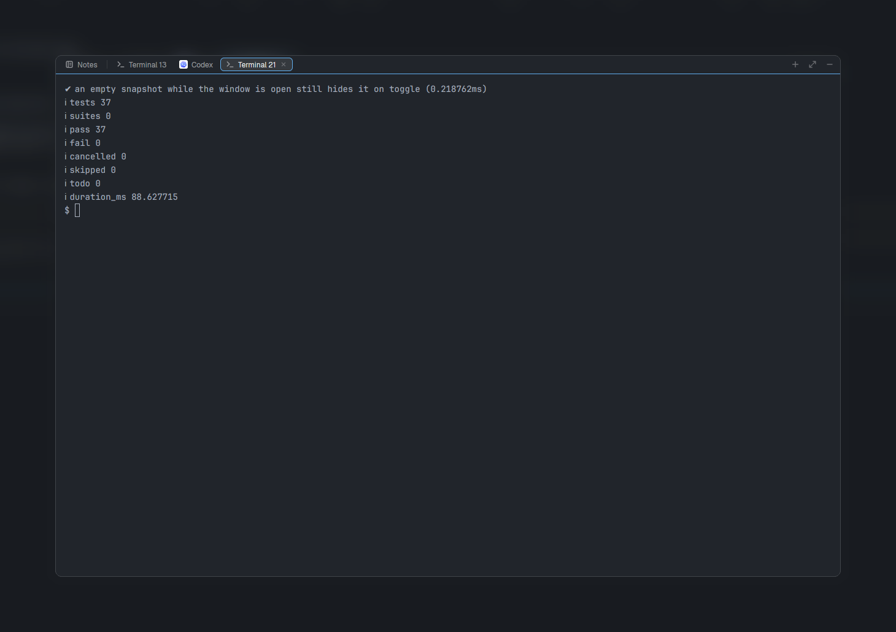

# Herdr Float Space

A floating scratch window for the [Herdr](https://herdr.dev) desktop app:
terminal tabs of its own and autosaved Notes shared across all your spaces.
Press **Ctrl+Shift+Space**, run a side task or jot something down, press it
again and you're back where you were. Your layout stays as it is.

This fork adds bottom-right drag resizing to
[thuanlm215/herdr-float-space](https://github.com/thuanlm215/herdr-float-space).
It uses the desktop mod API without changing the Herdr binary.



## Use

- **Ctrl+Shift+Space** shows/hides it, in any layout.
- With the **header or Notes focused**, **Ctrl+Tab** / **Ctrl+Shift+Tab**
  cycle through Notes and terminal tabs, **Ctrl+Shift+T** adds a shell, and
  **Ctrl+Shift+N** opens Notes. Notes takes the keyboard when opened.
  These bindings are scoped to the mod: when typing in an embedded terminal,
  Herdr's terminal/workspace bindings still apply. Click the header to use
  Float Space's tab shortcuts; Herdr 0.1.11 has no separate key context for
  an overlay terminal.
- Click a terminal to type. **+** adds another shell, starting in the folder
  the open space's terminal is in now (up to 12), the same place a new Herdr
  tab starts. A space on another machine starts in your home directory.
  Shells are numbered like Herdr's tabs: the lowest number no open tab uses.
- Switch tabs inside the window without touching the space behind it. Agents
  show their own name and icon, with Herdr's working spinner and
  blocked/done dots. As in Herdr, the done dot goes away once you've seen
  that tab, even if the agent keeps reporting done.
- An agent in Float Space that finishes or needs you gets Herdr's own agent
  toast ("Codex finished", "Codex needs you") and sound, unless you're
  watching it: Herdr is the active app, the keyboard is in Float Space and
  that tab is shown. The sounds follow `sounds` in Herdr's settings (your
  own files, or off). **Click the toast to open that agent's tab**, even if
  you have since hidden Float Space. An expired or closed terminal is
  reported without starting a replacement. With the optional status-bar
  button in your layout, this also works while Float Space is hidden;
  without it, agents are watched only while the window is open.
- The status-bar button shows a dot in Herdr's yellow (its working color)
  when an agent finished and you haven't seen it yet. It goes away once that
  tab shows in the open window while Herdr is the active app.
- While the keyboard is in Float Space (its terminal, Notes or header), its
  border turns your theme's accent color; clicking outside turns it back.
  Herdr keeps drawing the pane underneath as focused too; Float's border is
  the one to trust.
- **Notes** leads the header and can't be closed: one scratchpad shared
  across spaces, in your terminal font and size. It saves once you pause
  typing, and when you switch tabs or hide the window.
- **Window size** (diagonal arrows) has three presets: **Small** (20% × 50%,
  for notes or a quick command), **Normal** (50% × 60%, the default) and
  **Large** (85% × 88%, room for an agent). Sliders set any other size;
  **Apply** keeps it. Sizes share one window position. Drag free header
  space to move the window.
- **Drag the bottom-right arrows** to resize. An outline previews the size;
  release inside Herdr to apply it once. The terminal stays running and Notes
  are preserved. **Escape** cancels. Moving outside the scratch window is
  supported as long as the pointer remains inside Herdr.
- **−** hides the window and leaves shells and their programs running. The
  selected tab's **×** ends its terminal at once, like closing a tab in
  Herdr. When a terminal ends, the window shows the next tab, or Notes after
  the last one.

## Install

Requires the Herdr desktop app and `hc`. Drag resizing was tested on macOS
with Herdr **0.1.13** and core **0.1.18**. Upstream tested the original mod
on Linux with Herdr **0.1.11** and core **0.1.16**. This fork's drag behavior
has not been tested on Linux or Windows.

Float Space runs `hc` to start, list and end its own shells, and keeps Notes
as plaintext in Herdr's `shared.json`. It makes no network requests.

**With your Herdr agent:** ask it to add this mod from
`https://github.com/ohzw/herdr-float-space/tree/feat/drag-resize`. It copies
`mods/float-space` into the app and merges `keys.json`, as described in the
app's `AGENTS.md`.

**With the script**, from a clone of this repository:

```sh
python3 scripts/install.py --dry-run
python3 scripts/install.py
```

It copies the mod into `~/.config/herdr-app/mods/`, adds the shortcuts
without replacing any binding you already use, and backs up `keys.json`
under `~/.config/herdr-app/backups/float-space/`. It never touches a layout.
`--update` installs a newer checkout over a previous install and refuses to
overwrite files you edited. `--app-home <folder>` picks another Herdr home.
No restart is needed.

**By hand:** copy `mods/float-space` into `~/.config/herdr-app/mods/` and add
the bindings from `keys.json` to yours.

**Optional status-bar button**, if you keep a personal layout (a clone made
with "Duplicate layout"): put this block beside its `status` block. Besides
toggling the window, it shows a dot for a finished agent you haven't seen
and keeps the toasts and sounds coming while Float Space is hidden.

```json
{
  "id": "float-space-launcher",
  "type": "block",
  "size": { "px": 32 },
  "content": { "mod": "float-space", "props": { "role": "launcher" } }
}
```

## State and terminal ownership

Notes, tabs, the selected tab and the window size are saved under the
shared key `float-space.v1`, so they survive restarts. Herdr saves where
each window size was dropped in `windows.json`. Don't hand-edit
`shared.json` while Herdr runs.

Hiding Float Space or closing Herdr leaves its shells running while the
machine stays up. After a reboot, core brings them back as shells in their
last folder (`--keep`); a program or agent that was running is not
restarted. Resume an agent through its own commands.

Its terminals carry the labels `herdr.mod=float-space` and
`herdr.float-space=<app home>`. Float Space asks core for terminals with
both labels before showing or ending one, so it never ends a terminal that
isn't its own, and it finds its shells again if its saved tab list is lost.

## Current limits

- Herdr 0.1.10 can't focus an overlay terminal for a mod, so opening the
  window focuses its header: click the terminal before typing.
- Switching layouts closes the window; the shortcut opens it again with the
  same terminals and notes.
- Mods can't add entries to the command palette (Ctrl+Shift+P) yet; use the
  shortcut.
- Right-clicking a Float Space terminal shows Herdr's pane menu, and its
  Split, Zoom and Close pane items don't work there (a mod can't replace that
  menu for its own window). Use **+** and the tab's **×**; "Send right-clicks
  to pane" works.
- Drag resizing previews an outline, not live terminal content. It applies
  the size by replacing the overlay once on release.
- Only the bottom-right corner resizes. The presets and sliders remain
  available as a non-drag alternative.
- Herdr does not deliver mouse releases outside its app window. A new click
  or Escape cancels a tracker left open by such a release. Losing app focus
  also cancels it.

## Development

```sh
npm test
python3 -m unittest discover -s tests -p 'test_*.py'
herdr-app check mods/float-space
```

No npm packages or build step. `model.js` holds saved state and the window's
layout, `controller.js` the window's lifecycle, `main.js` the views and Herdr
calls. [RECIPE.md](RECIPE.md) is the brief to rebuild it from scratch;
[docs/validation.md](docs/validation.md) records the checks run on the real
app. See [CONTRIBUTING.md](CONTRIBUTING.md) before sending a change.

## Remove

Hide Float Space, remove its `ctrl-shift-space` bindings and the
`mod:float-space` section from `keys.json`
(and the button block, if you added one), then delete
`~/.config/herdr-app/mods/float-space`. Notes and shells stay. To end the
shells too, close their tabs first, or list them with
`hc ls --json --label herdr.mod=float-space` and end only the ones whose
`herdr.float-space` label is your app home.

MIT licensed. An independent community project, not affiliated with Herdr.
